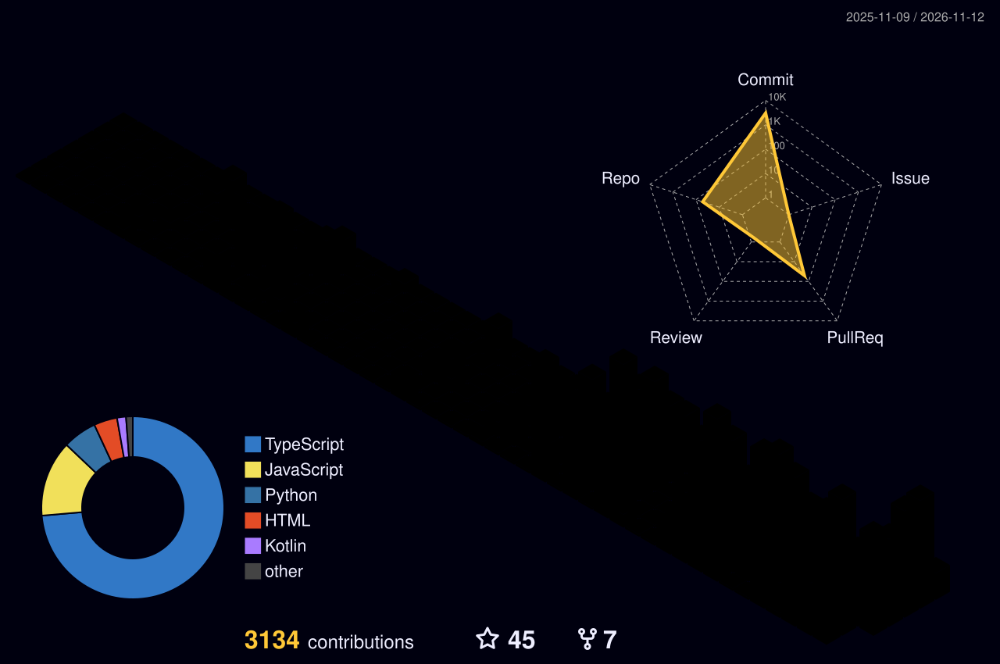

<!-- 01 · HERO VIEWFINDER HUD (1280×740) — dark/light twins -->
<a href="https://github.com/SudhirDevOps1" target="_blank">
<picture>
    <source media="(prefers-color-scheme: dark)" srcset="./assets/hero-viewfinder.svg?v=20261106-19"/>
    <source media="(prefers-color-scheme: light)" srcset="./assets/hero-viewfinder-light.svg?v=20261106-19"/>
    
  </picture>
</a>

  

<!-- STATS:HERO:START -->
  
  &#160;
  
<!-- STATS:HERO:END -->

  

<!-- 02 · WHAT I BUILD — SYSTEMS COMMAND COCKPIT (1280×540) -->

  

<!-- 03 · TECH ARSENAL — TACTICAL ORBITAL RADAR HUD (1280×560) -->

  

<!-- 04 · DEV LANYARD + LIVE TELEMETRY DASHBOARD (1280×620) — GENERATED -->

  

<!-- 05 · S-RANK MISSIONS — BLUEPRINT SHEET (1280×520) — GENERATED -->

  

<!-- 05b · SHIP LOG — WHAT SHIPPED YESTERDAY (1280×330) — GENERATED -->

  

<!-- STATS:TABLE:START -->

📦 <strong>78</strong> repositories &#160;·&#160; ⭐ <strong>44</strong> stars &#160;·&#160; 🍴 <strong>7</strong> forks &#160;·&#160; 💻 <strong>3,124</strong> commits &#160;·&#160; 🔀 <strong>46</strong> pull requests &#160;·&#160; 🐞 <strong>1</strong> issues &#160;·&#160; 👥 <strong>12</strong> followers &#160;·&#160; ✅ verified <strong>07 November 2026</strong>

<!-- STATS:TABLE:END -->

<strong>Data Integrity Invariant:</strong> Every number is pulled directly from the GitHub REST API v3 and Search API during scheduled runs. Zero fake data.

  

## 🎯 S-Rank Production Missions

<!-- STATS:FLAGSHIP:START -->
| Mission | Architectural Scope | Jutsu / Tech Stack | Stars |
|:---|:---|:---|:---:|
| 🎨 **[code-to-image-generator](https://github.com/SudhirDevOps1/code-to-image-generator)** | 🎨 Transform your code snippets into beautiful, shareable images with syntax highlighting - PWA Ready | <code>JavaScript</code> |  |
| 🎧 **[Brainwave-Audio-Tone-Generator](https://github.com/SudhirDevOps1/Brainwave-Audio-Tone-Generator)** | A beautiful, responsive, production-level application for generating brainwave entrainment audio tones with stunning UI and comprehensive features.  Supports binaural beats, monaural beats, isochronic tones, and pure sine waves. Background noise mixing, waveform preview, batch generation, and more.  | <code>Python</code> |  |
| ⚡ **[NovaPulse](https://github.com/SudhirDevOps1/NovaPulse)** | Production engineering mission · zero fake data. | <code>JavaScript</code> |  |
| 🚀 **[FlowTrack-Pro](https://github.com/SudhirDevOps1/FlowTrack-Pro)** | 🚀 FlowTrack Pro: Local-first productivity & study tracker ecosystem. Active window tracking, developer IDE telemetry, Pomodoro timer, 20-20-20 rest synthesizer, and zero-cloud privacy. | <code>TypeScript</code> |  |
| 📋 **[FormForge](https://github.com/SudhirDevOps1/FormForge)** | Production engineering mission · zero fake data. | <code>TypeScript</code> |  |
<!-- STATS:FLAGSHIP:END -->

 

<a href="https://github.com/SudhirDevOps1?tab=repositories">
<!-- STATS:REPOS:START -->
  
<!-- STATS:REPOS:END -->
</a>

  

### 🏘️ My Contribution Skyline

*Every commit constructs another building in the skyline — rebuilt daily via GitHub Actions:*

  

<picture>
  <source media="(prefers-color-scheme: dark)" srcset="https://raw.githubusercontent.com/SudhirDevOps1/SudhirDevOps1/output/github-contribution-grid-snake-dark.svg"/>
  <source media="(prefers-color-scheme: light)" srcset="https://raw.githubusercontent.com/SudhirDevOps1/SudhirDevOps1/output/github-contribution-grid-snake.svg"/>
  
</picture>

  

<!-- 07 · STREAK BUDDY — REAL-TIME CONTRIBUTION CADENCE (620×200) -->

  

<!-- 06 · CONNECT — IDENTITY + CHANNELS (1280×460) -->

 

  

  

Engineered by hand &bull; Refreshed by automation &bull; Every single metric verified against GitHub REST API v3

<!-- STATS:MILESTONES:START -->

🗓️ on GitHub since <strong>25 September 2025</strong> &#160;·&#160; <strong>407</strong> days of shipping &#160;·&#160; 📍 Bihar, India &#160;·&#160; 🌐 <a href="https://sudhirdevops1.github.io">sudhirdevops1.github.io</a>

<!-- STATS:MILESTONES:END -->

<!-- STATS:SYNC:START -->
🤖 Auto-synced <strong>07 November 2026</strong> &bull; every number above pulled live from the GitHub API &bull; last run 07/11/2026, 00:53:14 IST
<!-- STATS:SYNC:END -->

