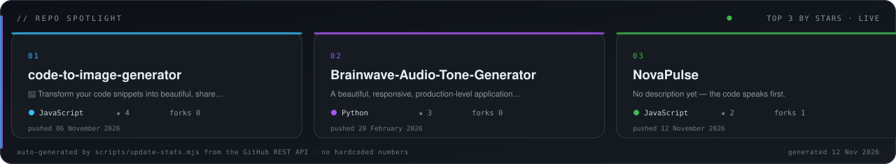

<!--
================================================================================
  README.md — SudhirDevOps1 GitHub Profile
  Author : Sudhir Singh · Data : GitHub REST API v3 + Search API (100% REAL)

  Self-hosted artwork — hand-drawn SVG, zero third-party banners:
    assets/hero-scene.svg     the build room: editor, terminal, pipeline
    assets/what-i-build.svg   build · automate · design
    assets/stack-arsenal.svg  16 tools, one glyph language
    assets/dev-id.svg         GENERATED daily — identity card + live dashboard
    assets/repo-spotlight.svg GENERATED daily — top 3 repos by stars
    assets/streak-buddy.svg   GENERATED daily — contribution streak
    assets/connect-panel.svg  four channels
    assets/signature.svg      signed footer
    assets/divider.svg        section rule

  Tokens: #0B0F17/#121826 surface · #30363D border · #36BCF7 · #A855F7 · #3FB950
  Motion: entrance fades + slow loops only; every asset honours
          prefers-reduced-motion. No raster, no embedded fonts, no GIFs.
================================================================================
-->

<a href="https://github.com/SudhirDevOps1" target="_blank">
  
</a>

<div align="center">


<br/>


<br/>

<!-- STATS:HERO:START -->
  
  &nbsp;
  
<!-- STATS:HERO:END -->

<br/><br/>

<sub><a href="#about">About</a> · <a href="#build">What I Build</a> · <a href="#stack">Arsenal</a> · <a href="#id">Developer ID</a> · <a href="#spotlight">Spotlight</a> · <a href="#projects">Projects</a> · <a href="#activity">Activity</a> · <a href="#automation">Automation</a> · <a href="#connect">Connect</a></sub>

</div>


<a id="about"></a>

## 🙋‍♂️ About

I'm **Sudhir Singh** — a BCA student in **Bihar, India**, building real web tools, study utilities, media apps and automation scripts. I care about software you can open, run and verify, not screenshots of software.

🎓 BCA &nbsp;·&nbsp; 📍 Bihar, India &nbsp;·&nbsp; 🌐 [sudhirdevops1.github.io](https://sudhirdevops1.github.io) &nbsp;·&nbsp; 🤝 Open to internships, full-time and freelance &nbsp;·&nbsp; ⚡ I debug at midnight and it still makes sense

<a id="build"></a>



<a id="stack"></a>



<a id="id"></a>
<a id="stats"></a>



<!-- STATS:TABLE:START -->
<div align="center"><sub>📦 <strong>77</strong> repositories &nbsp;·&nbsp; ⭐ <strong>44</strong> stars &nbsp;·&nbsp; 🍴 <strong>7</strong> forks &nbsp;·&nbsp; 💻 <strong>3,047</strong> commits &nbsp;·&nbsp; 🔀 <strong>46</strong> pull requests &nbsp;·&nbsp; 🐞 <strong>1</strong> issues &nbsp;·&nbsp; 👥 <strong>12</strong> followers &nbsp;·&nbsp; ✅ verified <strong>04 November 2026</strong></sub></div>
<!-- STATS:TABLE:END -->

<div align="center"><sub><strong>Redrawn every day.</strong> <code>scripts/update-stats.mjs</code> rebuilds this card from the GitHub REST + Search API, so the numbers can't quietly go stale.</sub></div>

<a id="spotlight"></a>



<div align="center"><sub><strong>Top 3 by stars, live.</strong> Language, stars, forks and the last push date all come straight from the API.</sub></div>


<a id="projects"></a>

## 🚀 Featured Projects

| Project | What it does | Signals |
|:--|:--|:--|
| 🎨 **[code-to-image-generator](https://github.com/SudhirDevOps1/code-to-image-generator)** | Turns code snippets into shareable, syntax-highlighted images. Installable PWA. |  |
| 🎧 **[Brainwave-Audio-Tone-Generator](https://github.com/SudhirDevOps1/Brainwave-Audio-Tone-Generator)** | Binaural beats, isochronic tones and pure sine waves with waveform preview and batch generation. |  |
| ⏱️ **[The-Ultimate-Master-Study-Tracker](https://github.com/SudhirDevOps1/The-Ultimate-Master-Study-Tracker)** | FlowTrack Pro: local-first productivity system with Pomodoro, IDE telemetry and zero-cloud privacy. |  |
| 🔐 **[SafeVault](https://github.com/SudhirDevOps1/SafeVault)** | Offline-first, zero-knowledge credential manager with a desktop app and an interactive CLI. |  |
| 🛡️ **[BlindShare](https://github.com/SudhirDevOps1/BlindShare)** | End-to-end encrypted document sharing; the server is only a blind courier (AES-GCM-256). |  |

<div align="center">

<a href="https://github.com/SudhirDevOps1?tab=repositories">
  <!-- STATS:REPOS:START -->
  
<!-- STATS:REPOS:END -->
</a>

</div>


<a id="activity"></a>

## 📈 Activity

<div align="center">

<a href="https://github.com/SudhirDevOps1">
  
</a>

<br/>

<a href="https://github.com/SudhirDevOps1">
  
</a>
<a href="https://github.com/SudhirDevOps1">
  
</a>

<br/><br/>

<a href="https://github.com/SudhirDevOps1">
  
</a>

<br/><br/>

<a href="https://github.com/SudhirDevOps1">
  
</a>

<br/><br/>

<picture>
  <source media="(prefers-color-scheme: dark)" srcset="https://raw.githubusercontent.com/SudhirDevOps1/SudhirDevOps1/output/github-contribution-grid-snake-dark.svg"/>
  <source media="(prefers-color-scheme: light)" srcset="https://raw.githubusercontent.com/SudhirDevOps1/SudhirDevOps1/output/github-contribution-grid-snake.svg"/>
  
</picture>

<br/><br/>


</div>


<a id="automation"></a>

## 🛰️ Live Automation

```text
cron (GitHub Actions)
  ├─ update-stats.mjs   → REST v3 + Search API → README blocks + dev-id.svg + repo-spotlight.svg
  ├─ update-streak.mjs  → GraphQL calendar → streak-buddy.svg
  ├─ git commit + push  → github-actions[bot] keeps this page fresh, daily
  └─ check-readme-health.mjs + check-svg.mjs → every image, link and asset, verified live
```

- **Update Profile Stats** — recomputes every number, redraws two cards &nbsp;·&nbsp; `daily · 02:30 UTC` &nbsp;·&nbsp; 
- **README Health Check** — gates the SVGs, then loads every image and link &nbsp;·&nbsp; `daily · 04:00 UTC` &nbsp;·&nbsp; 
- **Contribution Snake** &nbsp;·&nbsp; `every 12 hours` &nbsp;·&nbsp; 
- **3D Contribution Calendar** &nbsp;·&nbsp; `daily · 18:00 UTC` &nbsp;·&nbsp; 

If a source stops responding, the badge goes red instead of quietly lying.


<a id="connect"></a>



<div align="center">

<a href="https://linkedin.com/in/SudhirDevOps1"></a>
<a href="https://t.me/SudhirDevOps1"></a>
<a href="https://github.com/SudhirDevOps1/SudhirDevOps1"></a>

<br/><br/>

> 💡 Got an idea, a collaboration, an internship or a freelance project? **I'm open to work — let's talk.**

<br/>


<br/>

<sub>Built and drawn by hand · refreshed by robots · every number verified</sub>

<!-- STATS:MILESTONES:START -->
<div align="center"><sub>🗓️ on GitHub since <strong>25 September 2025</strong> &nbsp;·&nbsp; <strong>404</strong> days of shipping &nbsp;·&nbsp; 📍 Bihar, India &nbsp;·&nbsp; 🌐 <a href="https://sudhirdevops1.github.io">sudhirdevops1.github.io</a></sub></div>
<!-- STATS:MILESTONES:END -->

<!-- STATS:SYNC:START -->
<sub>🤖 Auto-synced <strong>04 November 2026</strong> &bull; every number above pulled live from the GitHub API &bull; last run 04/11/2026, 19:12:49 IST</sub>
<!-- STATS:SYNC:END -->

</div>
