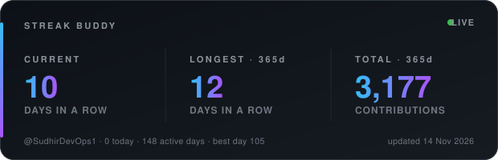

<!--
================================================================================
  README.md — SudhirDevOps1 GitHub Profile
  Author      : Sudhir Singh
  Data Source : GitHub REST API v3 + Search API (PUBLIC) — 100% REAL
  Verified on : November 2026
  Website     : https://sudhirdevops1.github.io
  Hero asset  : assets/hero-banner.svg (self-hosted — no third-party banner dependency)
  NOTE: All stats are REAL-TIME — zero fake data.
================================================================================
-->

<!-- ═══════════════════════ ANIMATED HERO BANNER (self-hosted, hand-drawn SVG) ═══════════════════════ -->
<a href="https://github.com/SudhirDevOps1" target="_blank">
  
</a>

<!-- ═══════════════════════ TYPING ANIMATION ═══════════════════════ -->
<div align="center">
  <a href="https://github.com/SudhirDevOps1">
    
  </a>

  <br/><br/>

  
  &nbsp;
  
  &nbsp;
  
  &nbsp;
  

  <br/><br/>

  <!-- STATS:HERO:START -->
  
  &nbsp;
  
<!-- STATS:HERO:END -->
  &nbsp;
  
  &nbsp;
  

  <br/><br/>

  <a href="https://linkedin.com/in/SudhirDevOps1">
    
  </a>
</div>

<br/>

<!-- ═══════════════════════ ABOUT ME + AVATAR ═══════════════════════ -->
<table width="100%">
<tr>
<td width="58%" valign="top">

## 🙋‍♂️ About Me

I am **Sudhir Singh**, a passionate **BCA student** from **Bihar, India**, building practical web tools, study utilities, media apps, and automation scripts.
My goal: become a **full-stack developer** who ships real-world products.

> 🎯 **Mission — ship real things, automate the boring ones, document honestly.**

| | |
|---|---|
| 🎓 **Degree** | Bachelor of Computer Applications (BCA) |
| 📍 **Location** | Bihar, India |
| 💻 **Current Focus** | Full-Stack Web Development |
| 🔒 **Exploring** | Cyber Security & System Design |
| 🌱 **Learning** | Python, TypeScript, Cloud & DevOps |
| 🤖 **Interested in** | AI/ML, Automation, Open Source |
| 🌐 **Portfolio** | [sudhirdevops1.github.io](https://sudhirdevops1.github.io) |
| 📫 **Contact** | Available on [LinkedIn](https://linkedin.com/in/SudhirDevOps1) |
| ⚡ **Fun Fact** | I debug at midnight and it still makes sense 😄 |

</td>
<td width="42%" align="center" valign="top">

<br/>

<a href="https://github.com/SudhirDevOps1">
  
</a>

<br/><br/>

<a href="https://github.com/SudhirDevOps1">
  
</a>

<br/><br/>


&nbsp;


</td>
</tr>
</table>

<br/>

<!-- ═══════════════════════ WHAT I BRING ═══════════════════════ -->
## ⚡ What I Bring To The Table

<table width="100%">
<tr>
<td width="33%" valign="top">

### 🧱 Build
Complete, shipped applications — not tutorials.
React + TypeScript frontends, Python backends, clean state management and real API integrations.

</td>
<td width="33%" valign="top">

### ⚙️ Automate
Python & Bash scripts, GitHub Actions, scheduled workflows.
If a task repeats three times, I write code so it repeats zero times.

</td>
<td width="33%" valign="top">

### 🎨 Design
Interfaces with intent — dark themes, accessible contrast, tight spacing, purposeful motion.
Built with Tailwind CSS 4 and a design-token mindset.

</td>
</tr>
</table>

<br/>

<!-- ═══════════════════════ HOW I WORK ═══════════════════════ -->
## 🔁 How I Work

<table width="100%">
<tr>
<td width="33%" valign="top">

### 🚀 Ship > Talk
Working software over roadmaps and promises. Every claim on this page points to something you can open, run and verify — right now.

</td>
<td width="33%" valign="top">

### 🤖 Automate > Repeat
If a task happens three times, it becomes a script or a scheduled workflow. This very profile refreshes itself every single day.

</td>
<td width="33%" valign="top">

### 🔍 Real > Fake
Verified numbers or a red badge. Every stat here comes from the GitHub API — nothing is estimated, cached forever or made up.

</td>
</tr>
</table>

<br/>

<!-- ═══════════════════════ CONNECT ═══════════════════════ -->
<div align="center">

## 🌐 Connect With Me

<a href="https://github.com/SudhirDevOps1">
  
</a>
&nbsp;
<a href="https://linkedin.com/in/SudhirDevOps1">
  
</a>
&nbsp;
<a href="https://t.me/SudhirDevOps1">
  
</a>

</div>

<br/>

<!-- ═══════════════════════ LIVE STATS TABLE ═══════════════════════ -->
<div align="center">

## 📊 Verified GitHub Statistics

> 🟢 **All data is fetched LIVE from the GitHub REST API v3 + Search API — zero fake numbers.**

<!-- STATS:TABLE:START -->
| Metric | Value |
|:--|:--|
| 👤 **Name** | Sudhir Singh |
| 🆔 **Username** | [`@SudhirDevOps1`](https://github.com/SudhirDevOps1) |
| 📍 **Location** | Bihar, India |
| 🌐 **Website** | [sudhirdevops1.github.io](https://sudhirdevops1.github.io) |
| 📦 **Public Repositories** | **77** *(Live from API)* |
| ⭐ **Total Stars Earned** | **44** *(Live from API)* |
| 🍴 **Total Forks** | **7** *(Live from API)* |
| 💻 **Commits Authored** | **3,025** *(Search API)* |
| 🔀 **Pull Requests** | **46** *(Search API)* |
| 🐞 **Issues Opened** | **1** *(Search API)* |
| 👥 **Followers** | **12** *(Live from API)* |
| ➡️ **Following** | **19** *(Live from API)* |
| 🗓️ **Joined GitHub** | 25 September 2025 |
| ✅ **Last Verified** | 04 November 2026 |
<!-- STATS:TABLE:END -->

<br/>


&nbsp;

&nbsp;


</div>

<br/>

<!-- ═══════════════════════ TECH STACK ═══════════════════════ -->
## 🛠️ Tech Stack & Tools

<div align="center">

### 🌐 Frontend
<a href="https://skillicons.dev">
  
</a>

<br/>

### 🐍 Backend & Scripting
<a href="https://skillicons.dev">
  
</a>

<br/>

### 🔧 Dev Tools & Platforms
<a href="https://skillicons.dev">
  
</a>

<br/>

### ☁️ DevOps & Extras
<a href="https://skillicons.dev">
  
</a>

<br/><br/>


</div>

<br/>


<br/>

<!-- ═══════════════════════ FEATURED PROJECTS ═══════════════════════ -->
## 🚀 Featured Projects

<div align="center">

> 🧠 Real, working applications I designed, built and shipped — live on GitHub.

| 🚀 Project & What it does | Signals |
|:--|:--|
| 🎨 **[code-to-image-generator](https://github.com/SudhirDevOps1/code-to-image-generator)** — turns code snippets into beautiful, shareable images with syntax highlighting. PWA ready. |   |
| 🎧 **[Brainwave-Audio-Tone-Generator](https://github.com/SudhirDevOps1/Brainwave-Audio-Tone-Generator)** — binaural beats, isochronic tones & pure sine waves with waveform preview and batch generation. |   |
| ⏱️ **[The-Ultimate-Master-Study-Tracker](https://github.com/SudhirDevOps1/The-Ultimate-Master-Study-Tracker)** — FlowTrack Pro: local-first productivity ecosystem with Pomodoro, IDE telemetry and zero-cloud privacy. |   |
| 🔐 **[SafeVault](https://github.com/SudhirDevOps1/SafeVault)** — offline-first, zero-knowledge credential manager with a desktop app and an interactive CLI. |   |
| 🛡️ **[BlindShare](https://github.com/SudhirDevOps1/BlindShare)** — end-to-end encrypted document sharing & deck analytics; the server is only a blind courier (AES-GCM-256). |   |

<br/>

<a href="https://github.com/SudhirDevOps1?tab=repositories">
  <!-- STATS:REPOS:START -->
  
<!-- STATS:REPOS:END -->
</a>

</div>

<br/>


<br/>

<!-- ═══════════════════════ GITHUB STATS CARDS ═══════════════════════ -->
## 📈 GitHub Statistics

<div align="center">

<a href="https://github.com/SudhirDevOps1">
  
</a>
<a href="https://github.com/SudhirDevOps1">
  
</a>

<br/><br/>

<a href="https://github.com/SudhirDevOps1">
  
</a>
<a href="https://github.com/SudhirDevOps1">
  
</a>

<br/><br/>

<a href="https://github.com/SudhirDevOps1">
  
</a>

<br/><br/>

<a href="https://github.com/SudhirDevOps1">
  
</a>

</div>

<br/>

<!-- ═══════════════════════ FULL HEATMAP ═══════════════════════ -->
## 🗓️ Full Contribution Heatmap

<div align="center">
  <a href="https://github.com/SudhirDevOps1">
    
  </a>
</div>

<br/>

<!-- ═══════════════════════ 3D CALENDAR ═══════════════════════ -->
## 🧊 3D Contribution Calendar

<div align="center">
  <a href="https://github.com/SudhirDevOps1">
    
  </a>
</div>

<br/>

<!-- ═══════════════════════ TROPHIES ═══════════════════════ -->
## 🏆 GitHub Trophies

<div align="center">
  
</div>

<br/>

<!-- ═══════════════════════ ACTIVITY GRAPH ═══════════════════════ -->
## 📅 Contribution Activity Graph

<div align="center">
  <a href="https://github.com/SudhirDevOps1">
    
  </a>
</div>

<br/>

<!-- ═══════════════════════ SNAKE ═══════════════════════ -->
## 🐍 Contribution Snake

<div align="center">
  <picture>
    <source media="(prefers-color-scheme: dark)" srcset="https://raw.githubusercontent.com/SudhirDevOps1/SudhirDevOps1/output/github-contribution-grid-snake-dark.svg"/>
    <source media="(prefers-color-scheme: light)" srcset="https://raw.githubusercontent.com/SudhirDevOps1/SudhirDevOps1/output/github-contribution-grid-snake.svg"/>
    
  </picture>
</div>

<br/>

<!-- ═══════════════════════ STREAK BUDDY ═══════════════════════ -->
## 🦊 Animated Streak Buddy

<div align="center">
  <a href="https://github.com/SudhirDevOps1">
    
  </a>

  <sub><b>Drawn by my own workflow</b> — <code>scripts/update-streak.mjs</code> reads the contribution calendar every day and redraws this card. No third-party cache, no stale numbers.</sub>
</div>

<br/>


<br/>

<!-- ═══════════════════════ ROADMAP ═══════════════════════ -->
## 🎯 2026 Roadmap

<div align="center">

| 🎯 Goal | 📌 Why it matters | 🚦 Status |
|:--|:--|:--|
| **Full-stack mastery** — React 19 + TypeScript | Ship production apps end-to-end | 🟢 In progress |
| **Cloud & DevOps** — Docker, CI/CD, Linux | Deploy and operate what I build | 🟡 Learning |
| **DSA & problem solving** — arrays → graphs | Think in complexity, not guesswork | 🟡 Ongoing |
| **Open source contributions** | Learn from real codebases and reviews | 🟢 Started |
| **AI / ML foundations** | Build tools that reason, not just render | ⚪ Exploring |
| **System design** | Design for scale before it breaks | ⚪ Exploring |

</div>

<br/>

<!-- ═══════════════════════ CURRENTLY WORKING ON ═══════════════════════ -->
## 📌 What I'm Currently Working On

```text
🌱  Python Automation       → Scripts for web scraping & task automation
☁️  Cloud & DevOps          → Docker, CI/CD and deployment pipelines
📚  DSA Practice            → Arrays, Trees, Graphs in Python & JS
🎨  UI/UX Projects          → Building modern, animated web interfaces
```

<br/>

<!-- ═══════════════════════ MILESTONES ═══════════════════════ -->
## 🏅 Milestones & Achievements

<div align="center">

<!-- STATS:MILESTONES:START -->
| 🏆 Milestone | 📈 Detail |
|:--|:--|
| 🗓️ **Joined GitHub** | 25 September 2025 |
| 📅 **Days since joining** | **404** days of shipping code |
| 📦 **Public repositories** | **77** shipped and open |
| 💻 **Commits authored** | **3,025** across all repositories |
| 🔀 **Pull requests** | **46** opened and merged through review |
| ⭐ **Stars earned** | **44** from the developer community |
| 🍴 **Forks received** | **7** — others building on my work |
| 🐍 **Automation** | Contribution snake + 3D calendar generated daily by GitHub Actions |
| 🧊 **3D contribution calendar** | Self-hosted, animated, regenerated every night |
<!-- STATS:MILESTONES:END -->

</div>

<br/>

<!-- ═══════════════════════ JOURNEY ═══════════════════════ -->
## 🧭 My Journey So Far

<div align="center">

| 🗓️ When | 🚀 Milestone |
|:--|:--|
| **Sep 2025** | Joined GitHub and shipped my first public repos — study tools & web utilities |
| **Oct–Dec 2025** | Built and open-sourced media apps, study trackers and code-to-image PWA |
| **2026** | Shipped SafeVault, BlindShare and applied TypeScript at production-grade quality |
| **Nov 2026** | This profile became **self-maintaining** — daily GitHub Actions, real API data, zero manual edits |

</div>

<br/>

<!-- ═══════════════════════ AUTOMATION & MONITORING ═══════════════════════ -->
## 🛰️ Live Automation & Monitoring

<div align="center">

> ⚙️ This profile **maintains itself**. Every workflow below runs on a schedule,
> pulls real data from the GitHub API, and turns **red on its own** if a source breaks.

**How it runs itself — the 20-second version:**

```text
cron (GitHub Actions)
  ├─ update-stats.mjs  → REST v3 + Search API → repos · stars · forks · commits · PRs · followers
  ├─                      └─ rewrites the STATS blocks in this README (marker-guarded)
  ├─ update-streak.mjs → GraphQL contribution calendar → assets/streak-buddy.svg
  ├─ git commit + push (github-actions[bot])   → this page stays fresh, daily
  └─ check-readme-health.mjs → verifies every image & link live · red badge on any failure
```

| ⚙️ Workflow | 🕒 Schedule | 🧠 What it actually does | 📡 Live status |
|:--|:--|:--|:--|
| **Update Profile Stats** | daily · 02:30 UTC | Recomputes repos, stars, forks, commits, PRs, issues, followers — then rewrites the tables above and redraws the streak card |  |
| **README Health Check** | daily · 04:00 UTC | Loads **every image and every link** on this page with retries, and fails if the streak card is stale — dead links, error cards and soft-404s all turn the badge red |  |
| **Contribution Snake** | every 12 hours | Regenerates the animated snake from real contribution data |  |
| **3D Contribution Calendar** | daily · 18:00 UTC | Rebuilds the isometric 3D calendar SVG |  |

<br/>

**No demo data. No placeholders. No fake numbers.**
If a value appears on this page, a workflow fetched it from the GitHub API —
and if a source stops responding, the badge above goes red instead of quietly lying.

</div>

<br/>


<br/>

<!-- ═══════════════════════ DEV QUOTE ═══════════════════════ -->
## 💡 Developer Quote

<div align="center">
  
</div>

<br/>

<!-- ═══════════════════════ DEV JOKE ═══════════════════════ -->
## 😄 Random Dev Joke

<div align="center">
  
</div>

<br/>

<!-- ═══════════════════════ CTA ═══════════════════════ -->
## 🤝 Let's Build Together

<div align="center">

> 💡 Got an idea, a collaboration, an internship or a freelance project?
> **I'm open to work — let's talk.**

<br/>

<a href="https://linkedin.com/in/SudhirDevOps1">
  
</a>
&nbsp;
<a href="https://t.me/SudhirDevOps1">
  
</a>
&nbsp;
<a href="https://github.com/SudhirDevOps1?tab=repositories">
  
</a>
&nbsp;
<a href="https://github.com/SudhirDevOps1/SudhirDevOps1">
  
</a>

<br/><br/>

> 🛠️ This profile is **100% self-maintaining** — a daily GitHub Actions pipeline
> refreshes every stat you see, live from the GitHub API, and commits it back.

</div>

<br/>

<!-- ═══════════════════════ FOOTER ═══════════════════════ -->
<div align="center">

<a href="https://github.com/SudhirDevOps1">
  
</a>

<br/><br/>

<sub><b>sudo ship_it --with-passion</b> · zero fake data · always shipping 🚀</sub>

<br/><br/>

<a href="https://github.com/SudhirDevOps1">
  
</a>

<!-- STATS:SYNC:START -->
<sub>🤖 Auto-synced <strong>04 November 2026</strong> &bull; every number above pulled live from the GitHub API &bull; last run 04/11/2026, 15:14:20 IST</sub>
<!-- STATS:SYNC:END -->

</div>
